# Bétula Human Authority Redesign Implementation Plan

> **For agentic workers:** REQUIRED SUB-SKILL: Use superpowers:subagent-driven-development (recommended) or superpowers:executing-plans to implement this plan task-by-task. Steps use checkbox (`- [ ]`) syntax for tracking.

**Goal:** Construir uma página institucional B2B totalmente nova para a Bétula RH, responsiva desde a concepção e visualmente ancorada em autoridade humana, fotografia real e identidade teal.

**Architecture:** Manter Astro com geração estática e conteúdo centralizado em `src/data/site.ts`. A experiência será composta por componentes Astro pequenos, estilos CSS organizados por responsabilidade e uma camada mínima de `IntersectionObserver` para menu, processo narrativo e WhatsApp flutuante. Não adicionar React: o único momento de alto impacto será resolvido com `position: sticky`, atributos de estado e transições CSS, mantendo todo conteúdo no HTML inicial.

**Tech Stack:** Astro 5, TypeScript, Tailwind CSS 4 já instalado, CSS nativo, Node test runner, Vercel static adapter.

---

## File map

### Create

- `PRODUCT.md`: contexto estratégico lido pelo Impeccable.
- `DESIGN.md`: sistema visual aprovado e critérios anti-template.
- `src/components/TrustStrip.astro`: experiência e logos em loop único.
- `src/components/HumanApproach.astro`: bloco fotográfico de autoridade humana.
- `src/components/ProcessStory.astro`: narrativa sticky do processo.
- `src/components/SocialProof.astro`: depoimento principal e provas secundárias.
- `src/components/TeamGallery.astro`: galeria editorial fotográfica.
- `src/components/icons/WhatsAppIcon.astro`: símbolo de marca do WhatsApp a partir de fonte oficial versionada.
- `src/styles/tokens.css`: cores, tipografia, espaçamento, raio e camadas.
- `src/styles/base.css`: reset, tipografia, containers, botões e acessibilidade.
- `src/styles/shell.css`: cabeçalho, hero, footer e WhatsApp.
- `src/styles/sections.css`: blocos de conteúdo e variações de composição.
- `src/styles/motion.css`: movimento, sticky story e reduced motion.

### Modify

- `src/pages/index.astro`: nova sequência de componentes.
- `src/layouts/Base.astro`: preload do hero, metadados e integração dos estilos.
- `src/data/site.ts`: separar copy substituível de dados verificados e mapear imagens.
- `src/components/Header.astro`: navegação limpa e CTA.
- `src/components/Hero.astro`: hero teal/fotografia 42/58.
- `src/components/Contato.astro`: fechamento teal e caminhos de contato separados.
- `src/components/Footer.astro`: rodapé compacto.
- `src/components/WhatsAppFloat.astro`: botão apenas com símbolo.
- `src/scripts/main.ts`: estados do processo, menu e CTA flutuante.
- `src/styles/global.css`: apenas agregador dos estilos.
- `tests/site-output.test.mjs`: contrato estrutural, SEO, conversão e anti-slop.
- `README.md`: arquitetura e verificação atualizadas.

### Retire from index

- `Manifesto.astro`
- `Atuacao.astro`
- `Processo.astro`
- `Experiencia.astro`
- `Time.astro`

Os arquivos antigos só serão removidos depois de `rg` confirmar que não são mais importados.

---

### Task 1: Establish Impeccable project context

**Files:**
- Create: `PRODUCT.md`
- Create: `DESIGN.md`

- [ ] **Step 1: Create the strategic context**

Create `PRODUCT.md` with the confirmed direction:

```markdown
# Product

## Register

brand

## Users

Gestores, lideranças e profissionais de Recursos Humanos que precisam contratar para empresas e buscam uma consultoria capaz de compreender negócio, cultura e contexto antes de iniciar a busca.

## Product Purpose

Apresentar a Bétula RH como consultoria de recrutamento e seleção com atuação em Campinas e em todo o Brasil, construir confiança e conduzir empresas a uma conversa pelo WhatsApp.

## Brand Personality

Humana, segura e criteriosa. A interface deve transmitir proximidade real, experiência e clareza sem parecer informal, fria ou excessivamente luxuosa.

## Anti-references

A página atual da prévia é a principal antirreferência: hero tipográfico excessivo, emblema cortado, fundo bege dominante, grandes vazios, três colunas iguais, listas lineares e estética editorial genérica. Também evitar partículas tecnológicas, glassmorphism, gradientes em texto, cards repetidos e fotografia de reunião como hero.

## Design Principles

1. Pessoas antes de ornamentos.
2. Método visível, sem burocracia visual.
3. Teal como presença de marca, não apenas como detalhe.
4. Um único gesto memorável por página.
5. Cada viewport recebe uma composição intencional.
6. Copy substituível sem quebrar o layout.

## Accessibility & Inclusion

WCAG 2.2 AA como base, foco visível, navegação por teclado, contraste verificado, áreas de toque adequadas e experiência completa com movimento reduzido ou JavaScript indisponível.
```

- [ ] **Step 2: Create the visual context**

Create `DESIGN.md` with these non-negotiable tokens and rules:

```markdown
# Design System

## Direction

Autoridade humana. Fotografia real, composição assimétrica controlada, teal dominante e um processo narrativo como único momento de alto impacto.

## Color

- Brand: #115F61
- Brand deep: #08494B
- Brand soft: #4E8F90
- Accent: #7A4A12
- Canvas: #FAFAF8
- Warm support: #F0E9DE
- Ink: #232323
- Muted ink: #555C59

Warm support never becomes the global page background. Accent stays below 10 percent of visible surface.

## Typography

- Display: Manrope Variable
- Body: Source Sans 3 Variable
- H1 maximum: 76px desktop, 48px mobile
- Display tracking floor: -0.035em
- Body measure: 65-75ch

## Shape

- Components: 8-12px radius
- Buttons: 10px radius
- Brand circle: signature only
- No decorative wide shadows

## Layout

- Container: 1240px
- Desktop hero: 42/58 color-to-photo split
- Mobile hero: copy first, portrait second
- No repeated equal-card grids
- No split section headers with floating side copy

## Motion

- Hero uses one mask-like curtain reveal.
- Client logos use the only marquee on the page.
- Process uses sticky progression on desktop and vertical flow on mobile.
- All other movement is interaction feedback.
- Reduced motion is complete and static.

## Imagery

- Hero: equipe-grupo-2.jpg
- Human approach: socias-2.jpg and retrato-a.jpg
- Process: office-candid.jpg
- Team: verified individual headshots plus equipe-grupo.jpg
- Do not use the existing meeting hero treatment.

## Bans

- No cream or beige global canvas.
- No giant clipped emblem.
- No three equal feature cards.
- No repeated eyebrow labels.
- No decorative numbering outside the real process.
- No gradient text, neon, glassmorphism or hand-drawn SVG decoration.
- No em dash or en dash in visible page copy.
```

- [ ] **Step 3: Verify context files**

Run:

```powershell
rg -n "^## Register|^brand$|Autoridade humana|#115F61|equipe-grupo-2" PRODUCT.md DESIGN.md
rg -n "TBD|TODO|FIXME|placeholder" PRODUCT.md DESIGN.md
```

Expected: the first command finds all required values; the second prints nothing.

- [ ] **Step 4: Commit**

```powershell
git add PRODUCT.md DESIGN.md
git commit -m "docs: registra contexto visual da Betula"
```

---

### Task 2: Replace the output contract before redesigning

**Files:**
- Modify: `tests/site-output.test.mjs`

- [ ] **Step 1: Replace copy-specific assertions with design structure assertions**

Keep the existing loader and replace the test cases with:

```js
test('renderiza uma página institucional com um único h1', () => {
  assert.equal((html.match(/<h1\b/g) ?? []).length, 1);
  assert.match(html, /data-hero/);
  assert.match(html, /class="hero-media"/);
  assert.match(html, /equipe-grupo-2\.jpg/);
});

test('mantém SEO local e canonical coerentes', () => {
  assert.match(html, /<title>Recrutamento e Seleção em Campinas \| Bétula RH<\/title>/);
  assert.match(html, /rel="canonical" href="https:\/\/betularh\.com\.br\/"/);
  assert.match(html, /"@type":"EmploymentAgency"/);
  assert.doesNotMatch(html, /"@type":"Review"/);
});

test('expõe a prova de confiança e o processo no HTML inicial', () => {
  assert.match(html, /data-trust-loop/);
  assert.match(html, /data-process-story/);
  assert.equal((html.match(/data-process-step/g) ?? []).length, 4);
  assert.match(html, /Compreensão/);
  assert.match(html, /Acompanhamento/);
});

test('usa fotografias reais como estrutura visual', () => {
  assert.match(html, /socias-2\.jpg/);
  assert.match(html, /office-candid\.jpg/);
  assert.match(html, /equipe-grupo\.jpg/);
  assert.match(html, /team-luciana-alvim\.jpg/);
});

test('oferece WhatsApp sem depender de formulário ou javascript', () => {
  assert.match(html, /https:\/\/wa\.me\/5519981389865\?text=/);
  assert.match(html, /data-whatsapp-float/);
  assert.match(html, /data-whatsapp-icon/);
  assert.doesNotMatch(html, /<form\b/);
  assert.doesNotMatch(html, /\/api\/contact/);
});

test('não reintroduz padrões visuais rejeitados', () => {
  assert.doesNotMatch(html, /hero-birch\.jpg/);
  assert.doesNotMatch(html, /hero-mark/);
  assert.doesNotMatch(html, /atuacao-grid/);
  assert.doesNotMatch(html, /section-index/);
  assert.doesNotMatch(html, /[—–]/);
});

test('não usa listener contínuo de scroll', () => {
  assert.doesNotMatch(html, /addEventListener\(["']scroll/);
});
```

- [ ] **Step 2: Run the contract and verify it fails**

Run:

```powershell
npm test
```

Expected: FAIL on `hero-media`, `data-trust-loop`, `data-process-story`, new image assets and WhatsApp icon. SEO assertions should still pass.

- [ ] **Step 3: Commit the failing contract**

```powershell
git add tests/site-output.test.mjs
git commit -m "test: define contrato visual de autoridade humana"
```

---

### Task 3: Build the page skeleton and content boundaries

**Files:**
- Modify: `src/pages/index.astro`
- Modify: `src/data/site.ts`
- Create: `src/components/TrustStrip.astro`
- Create: `src/components/HumanApproach.astro`
- Create: `src/components/ProcessStory.astro`
- Create: `src/components/SocialProof.astro`
- Create: `src/components/TeamGallery.astro`

- [ ] **Step 1: Add a centralized media map**

Append to `src/data/site.ts`:

```ts
export const media = {
  hero: '/assets/img/equipe-grupo-2.jpg',
  humanGroup: '/assets/img/socias-2.jpg',
  humanPortrait: '/assets/img/retrato-a.jpg',
  process: '/assets/img/office-candid.jpg',
  teamGroup: '/assets/img/equipe-grupo.jpg',
} as const;

export const pageCopy = {
  heroTitle: 'Antes do currículo, vem o contexto.',
  heroLead: 'Recrutamento e seleção em Campinas para empresas que precisam contratar com mais clareza e confiança.',
  heroPrimary: 'Conversar sobre uma contratação',
  heroSecondary: 'Conhecer nosso processo',
} as const;
```

The object is explicitly replaceable and contains no structural decisions.

- [ ] **Step 2: Replace the page composition**

Replace `src/pages/index.astro` with:

```astro
---
import Base from '../layouts/Base.astro';
import Header from '../components/Header.astro';
import Hero from '../components/Hero.astro';
import TrustStrip from '../components/TrustStrip.astro';
import HumanApproach from '../components/HumanApproach.astro';
import ProcessStory from '../components/ProcessStory.astro';
import SocialProof from '../components/SocialProof.astro';
import TeamGallery from '../components/TeamGallery.astro';
import Contato from '../components/Contato.astro';
import WhatsAppFloat from '../components/WhatsAppFloat.astro';
import Footer from '../components/Footer.astro';
---

<Base>
  <Header />
  <main id="conteudo">
    <Hero />
    <TrustStrip />
    <HumanApproach />
    <ProcessStory />
    <SocialProof />
    <TeamGallery />
    <Contato />
  </main>
  <WhatsAppFloat />
  <Footer />
</Base>
```

- [ ] **Step 3: Create semantic component shells**

Each new component must render its final section ID and real initial HTML. Use these roots:

```astro
<!-- TrustStrip.astro -->
<section class="trust-strip" aria-label="Experiência e clientes da Bétula" data-trust-loop></section>

<!-- HumanApproach.astro -->
<section class="human-approach" id="atuacao" aria-labelledby="human-title"></section>

<!-- ProcessStory.astro -->
<section class="process-story" id="processo" aria-labelledby="process-title" data-process-story></section>

<!-- SocialProof.astro -->
<section class="social-proof" id="experiencia" aria-labelledby="proof-title"></section>

<!-- TeamGallery.astro -->
<section class="team-gallery" id="equipe" aria-labelledby="team-title"></section>
```

Do not ship empty shells beyond this task. They exist only long enough to verify page wiring before the next tasks fill them.

- [ ] **Step 4: Verify Astro wiring**

Run:

```powershell
npm run check
npm run build
```

Expected: both commands exit 0. The output tests still fail because sections are not yet filled.

- [ ] **Step 5: Commit**

```powershell
git add src/pages/index.astro src/data/site.ts src/components/TrustStrip.astro src/components/HumanApproach.astro src/components/ProcessStory.astro src/components/SocialProof.astro src/components/TeamGallery.astro
git commit -m "refactor: cria esqueleto da nova experiencia Betula"
```

---

### Task 4: Establish tokens, base styles, header and hero

**Files:**
- Create: `src/styles/tokens.css`
- Create: `src/styles/base.css`
- Create: `src/styles/shell.css`
- Create: `src/styles/sections.css`
- Create: `src/styles/motion.css`
- Modify: `src/styles/global.css`
- Modify: `src/layouts/Base.astro`
- Modify: `src/components/Header.astro`
- Modify: `src/components/Hero.astro`

- [ ] **Step 1: Split global styles by responsibility**

Replace `src/styles/global.css` with:

```css
@import "tailwindcss";
@import "./tokens.css";
@import "./base.css";
@import "./shell.css";
@import "./sections.css";
@import "./motion.css";
```

Create `src/styles/tokens.css`:

```css
:root {
  color-scheme: light;
  --brand: #115f61;
  --brand-deep: #08494b;
  --brand-soft: #4e8f90;
  --accent: #7a4a12;
  --canvas: #fafaf8;
  --warm-support: #f0e9de;
  --ink: #232323;
  --muted: #555c59;
  --line: color-mix(in srgb, var(--brand) 18%, transparent);
  --font-display: "Manrope Variable", "Manrope", sans-serif;
  --font-body: "Source Sans 3 Variable", "Source Sans 3", sans-serif;
  --container: 77.5rem;
  --gutter: clamp(1rem, 3vw, 2.5rem);
  --space-section: clamp(4.5rem, 8vw, 8rem);
  --radius-sm: 8px;
  --radius-md: 12px;
  --layer-header: 30;
  --layer-float: 40;
}
```

Create `src/styles/base.css` with the reset, type and shared actions:

```css
*, *::before, *::after { box-sizing: border-box; }
html { scroll-behavior: smooth; scroll-padding-top: 4.5rem; overflow-x: clip; background: var(--canvas); }
body { margin: 0; min-width: 320px; overflow-x: clip; background: var(--canvas); color: var(--ink); font: 1rem/1.6 var(--font-body); text-rendering: optimizeLegibility; }
img, svg { display: block; max-width: 100%; }
a { color: inherit; text-underline-offset: .22em; }
button, a { -webkit-tap-highlight-color: transparent; }
:focus-visible { outline: 3px solid var(--accent); outline-offset: 4px; }
h1, h2, h3, p, figure, blockquote, ol, ul { margin-top: 0; }
h1, h2, h3 { font-family: var(--font-display); letter-spacing: -.03em; text-wrap: balance; }
p { text-wrap: pretty; }
.container { width: min(calc(100% - 2 * var(--gutter)), var(--container)); margin-inline: auto; }
.section { padding-block: var(--space-section); }
.button { display: inline-flex; min-height: 3rem; align-items: center; justify-content: center; padding: .75rem 1.1rem; border: 1px solid transparent; border-radius: var(--radius-md); font: 650 .95rem/1.2 var(--font-display); text-decoration: none; transition: transform 180ms cubic-bezier(.16,1,.3,1), background-color 180ms ease, color 180ms ease; }
.button:hover { transform: translateY(-2px); }
.button:active { transform: translateY(0) scale(.98); }
.button-primary { background: var(--canvas); color: var(--brand-deep); }
.button-secondary { border-color: currentColor; color: currentColor; }
.skip-link { position: fixed; top: .75rem; left: .75rem; z-index: 100; padding: .65rem 1rem; background: var(--ink); color: var(--canvas); transform: translateY(-180%); }
.skip-link:focus { transform: translateY(0); }
```

Create `src/styles/sections.css` with the first real rule. Later tasks append section-specific composition:

```css
.section { position: relative; isolation: isolate; }
```

Create `src/styles/motion.css` with the global accessibility fallback. Later tasks append hero, logo and process motion:

```css
@media (prefers-reduced-motion: reduce) {
  html { scroll-behavior: auto; }
  *, *::before, *::after {
    scroll-behavior: auto !important;
    animation-duration: .01ms !important;
    animation-iteration-count: 1 !important;
    transition-duration: .01ms !important;
  }
}
```

- [ ] **Step 2: Build the 42/58 hero with a real image**

Replace `src/components/Hero.astro` with:

```astro
---
import { media, pageCopy, whatsappHref } from '../data/site';
---

<section class="hero" data-hero aria-labelledby="hero-title">
  <div class="hero-copy">
    <div class="hero-copy-inner">
      <h1 id="hero-title">{pageCopy.heroTitle}</h1>
      <p>{pageCopy.heroLead}</p>
      <div class="hero-actions">
        <a class="button button-primary" href={whatsappHref()} target="_blank" rel="noopener">{pageCopy.heroPrimary}</a>
        <a class="hero-link" href="#processo">{pageCopy.heroSecondary}</a>
      </div>
    </div>
  </div>
  <figure class="hero-media">
    
    <span class="hero-signature" aria-hidden="true">
      
    </span>
    <span class="hero-curtain" aria-hidden="true"></span>
  </figure>
</section>
```

Replace `src/components/Header.astro` with:

```astro
---
import { navigation, whatsappHref } from '../data/site';
---

<header class="site-header" id="topo" data-header>
  <div class="container header-inner">
    <a href="#topo" class="brand" aria-label="Bétula RH, início">
      
    </a>
    <nav class="nav" aria-label="Navegação principal">
      <ul class="nav-list" id="menu-principal" data-menu>
        {navigation.map((item) => <li><a href={item.href}>{item.label}</a></li>)}
      </ul>
    </nav>
    <a class="button button-header header-cta" href={whatsappHref()} target="_blank" rel="noopener">Conversar sobre uma contratação</a>
    <button class="nav-toggle" data-toggle aria-label="Abrir menu" aria-expanded="false" aria-controls="menu-principal" type="button">
      <span></span><span></span><span></span>
    </button>
  </div>
</header>
```

In `src/layouts/Base.astro`, add before the manifest link:

```astro
<link rel="preload" as="image" href="/assets/img/equipe-grupo-2.jpg" fetchpriority="high" />
```

- [ ] **Step 3: Implement shell composition**

Create `src/styles/shell.css` with the final desktop/mobile rules:

```css
.site-header { position: sticky; top: 0; z-index: var(--layer-header); height: 4.5rem; background: color-mix(in srgb, var(--canvas) 94%, transparent); border-bottom: 1px solid var(--line); backdrop-filter: blur(12px); }
.header-inner { display: grid; height: 100%; grid-template-columns: auto 1fr auto; gap: clamp(1rem, 3vw, 2.25rem); align-items: center; }
.brand { display: block; width: 9rem; height: 2.8rem; overflow: hidden; }
.brand img { display: block; width: 100%; transform: translateY(-59%); }
.nav-list { display: flex; margin: 0; padding: 0; gap: clamp(.9rem, 2vw, 1.75rem); align-items: center; list-style: none; }
.nav-list a { font: 600 .9rem/1 var(--font-display); text-decoration: none; }
.button-header { background: var(--brand); color: var(--canvas); }
.nav-toggle { display: none; width: 2.75rem; height: 2.75rem; padding: .65rem; border: 1px solid var(--line); border-radius: 50%; background: transparent; }
.nav-toggle span { display: block; width: 100%; height: 1px; margin-block: .28rem; background: currentColor; transition: transform 180ms ease, opacity 180ms ease; }
.menu-open .nav-toggle span:nth-child(1) { transform: translateY(.56rem) rotate(45deg); }
.menu-open .nav-toggle span:nth-child(2) { opacity: 0; }
.menu-open .nav-toggle span:nth-child(3) { transform: translateY(-.56rem) rotate(-45deg); }
.hero { display: grid; min-height: calc(100dvh - 4.5rem); grid-template-columns: minmax(0, 42fr) minmax(0, 58fr); background: var(--brand); color: var(--canvas); }
.hero-copy { display: grid; align-items: center; padding: clamp(3rem, 7vw, 7rem) var(--gutter); }
.hero-copy-inner { width: min(100%, 32rem); margin-left: max(0px, calc((100vw - var(--container)) / 2)); }
.hero h1 { max-width: 10ch; margin-bottom: 1.5rem; font-size: clamp(3.25rem, 5vw, 4.75rem); line-height: .98; }
.hero-copy p { max-width: 32rem; margin-bottom: 2rem; color: color-mix(in srgb, var(--canvas) 82%, transparent); font-size: clamp(1.05rem, 1.4vw, 1.25rem); }
.hero-actions { display: flex; flex-wrap: wrap; gap: 1rem 1.25rem; align-items: center; }
.hero-link { font: 650 .95rem/1.2 var(--font-display); }
.hero-media { position: relative; min-height: inherit; margin: 0; overflow: hidden; }
.hero-media > img { width: 100%; height: 100%; object-fit: cover; object-position: 50% 42%; }
.hero-signature { position: absolute; bottom: 2rem; left: -2.2rem; width: 4.4rem; height: 4.4rem; padding: .45rem; border-radius: 50%; background: var(--brand); }
.hero-curtain { position: absolute; inset: 0; pointer-events: none; background: url('/assets/img/texture-birch-teal.png') center / cover no-repeat; mix-blend-mode: multiply; opacity: .2; }
@media (max-width: 760px) {
  .header-cta, .nav { display: none; }
  .nav-toggle { display: block; justify-self: end; }
  .menu-open .nav { position: absolute; top: 100%; right: 0; left: 0; display: block; padding: 1rem var(--gutter); background: var(--canvas); }
  .menu-open .nav-list { display: grid; gap: 0; }
  .menu-open .nav-list a { display: block; padding: .85rem 0; }
  .hero { min-height: auto; grid-template-columns: 1fr; }
  .hero-copy { min-height: calc(65dvh - 4.5rem); padding-block: 3.5rem; }
  .hero-copy-inner { margin-left: 0; }
  .hero h1 { font-size: clamp(2.65rem, 12vw, 3.5rem); }
  .hero-media { min-height: 46rem; }
  .hero-media > img { object-position: 53% center; }
  .hero-signature { bottom: 1.25rem; left: 1.25rem; }
}
```

- [ ] **Step 4: Verify hero and shell**

Run:

```powershell
npm run check
npm run build
node --test
```

Expected: Astro and build exit 0. The hero tests pass; remaining section tests still fail.

- [ ] **Step 5: Commit**

```powershell
git add src/styles src/layouts/Base.astro src/components/Header.astro src/components/Hero.astro
git commit -m "feat: cria hero de autoridade humana"
```

---

### Task 5: Build trust strip and human approach

**Files:**
- Modify: `src/components/TrustStrip.astro`
- Modify: `src/components/HumanApproach.astro`
- Modify: `src/styles/sections.css`

- [ ] **Step 1: Render one real logo loop**

`TrustStrip.astro` must import `clients`, duplicate the sequence only for seamless motion, hide the duplicate from accessibility and keep one factual experience statement:

```astro
---
import { clients } from '../data/site';
---

<section class="trust-strip" aria-label="Experiência e clientes da Bétula" data-trust-loop>
  <div class="trust-statement"><strong>Mais de 20 anos</strong><span>conectando empresas e profissionais</span></div>
  <div class="trust-viewport">
    <ul class="trust-track">
      {clients.map(([src, alt]) => <li></li>)}
      {clients.map(([src]) => <li aria-hidden="true"></li>)}
    </ul>
  </div>
</section>
```

- [ ] **Step 2: Build the asymmetrical human block**

`HumanApproach.astro` uses `media.humanGroup` and `media.humanPortrait` with one text block, no cards:

```astro
---
import { media } from '../data/site';
---

<section class="section human-approach" id="atuacao" aria-labelledby="human-title">
  <div class="container human-layout">
    <div class="human-copy">
      <h2 id="human-title">O contexto vem antes do currículo.</h2>
      <p>Uma contratação ganha precisão quando negócio, cultura, momento e pessoas são compreendidos juntos.</p>
    </div>
    <figure class="human-group"></figure>
    <figure class="human-portrait"></figure>
  </div>
</section>
```

- [ ] **Step 3: Add exact section composition**

Replace `src/styles/sections.css` with:

```css
.trust-strip { display: grid; grid-template-columns: minmax(13rem, .38fr) 1fr; align-items: center; overflow: hidden; border-bottom: 1px solid var(--line); background: var(--canvas); }
.trust-statement { display: grid; padding: 1.5rem var(--gutter); border-right: 1px solid var(--line); line-height: 1.15; }
.trust-statement strong { color: var(--brand); font: 680 1.1rem var(--font-display); }
.trust-statement span { color: var(--muted); font-size: .9rem; }
.trust-viewport { overflow: hidden; mask-image: linear-gradient(90deg, transparent, #000 7%, #000 93%, transparent); }
.trust-track { display: flex; width: max-content; margin: 0; padding: 1rem 0; align-items: center; list-style: none; animation: trust-loop 34s linear infinite; }
.trust-track li { display: grid; width: 10rem; min-height: 4rem; padding: .5rem 1.2rem; place-items: center; }
.trust-track img { width: 100%; height: 2.8rem; filter: grayscale(1); object-fit: contain; opacity: .6; }
.trust-viewport:hover .trust-track { animation-play-state: paused; }
.human-approach { background: var(--canvas); }
.human-layout { display: grid; grid-template-columns: repeat(12, minmax(0, 1fr)); gap: clamp(1rem, 2.5vw, 2rem); align-items: end; }
.human-copy { grid-column: 1 / span 5; align-self: start; padding-top: clamp(1rem, 6vw, 5rem); }
.human-copy h2 { max-width: 10ch; margin-bottom: 1.25rem; color: var(--brand-deep); font-size: clamp(2.5rem, 4.5vw, 4.5rem); line-height: 1; }
.human-copy p { max-width: 30rem; color: var(--muted); font-size: 1.15rem; }
.human-group { grid-column: 6 / -1; margin: 0; }
.human-group img { width: 100%; aspect-ratio: 3 / 2; border-radius: var(--radius-md); object-fit: cover; }
.human-portrait { grid-column: 3 / span 3; margin: -8rem 0 0; }
.human-portrait img { width: 100%; aspect-ratio: 2 / 3; border-radius: var(--radius-md); object-fit: cover; }
@media (max-width: 760px) {
  .trust-strip { grid-template-columns: 1fr; }
  .trust-statement { border-right: 0; border-bottom: 1px solid var(--line); }
  .human-layout { grid-template-columns: 1fr; }
  .human-copy, .human-group, .human-portrait { grid-column: 1; }
  .human-portrait { width: 58%; margin: -4rem 1rem 0 auto; }
}
```

- [ ] **Step 4: Run checks and commit**

```powershell
npm run check
npm test
git add src/components/TrustStrip.astro src/components/HumanApproach.astro src/styles/sections.css
git commit -m "feat: apresenta experiencia e pessoas reais"
```

Expected: build passes, trust and real-image assertions pass.

---

### Task 6: Build the signature sticky process

**Files:**
- Modify: `src/components/ProcessStory.astro`
- Modify: `src/scripts/main.ts`
- Modify: `src/styles/sections.css`
- Modify: `src/styles/motion.css`

- [ ] **Step 1: Render four process moments with all details in HTML**

Create the component from `processMoments`:

```astro
---
import { media, processMoments, whatsappHref } from '../data/site';
---

<section class="section process-story" id="processo" aria-labelledby="process-title" data-process-story data-active-process="0">
  <div class="container process-intro">
    <h2 id="process-title">Método para decidir com mais clareza.</h2>
  </div>
  <div class="container process-layout">
    <div class="process-visual" aria-hidden="true">
      
      
      <span class="process-progress"></span>
    </div>
    <ol class="process-moments">
      {processMoments.map((moment, index) => (
        <li class="process-moment" data-process-step data-step={index}>
          <span class="process-number" aria-hidden="true">{String(index + 1).padStart(2, '0')}</span>
          <h3>{moment.title}</h3>
          <p>{moment.summary}</p>
          <ul>{moment.steps.map((step) => <li>{step}</li>)}</ul>
        </li>
      ))}
    </ol>
  </div>
  <div class="container process-action"><a class="button button-secondary" href={whatsappHref()} target="_blank" rel="noopener">Conversar sobre uma contratação</a></div>
</section>
```

- [ ] **Step 2: Add process state without scroll listeners**

Append to `src/scripts/main.ts`:

```ts
const processStory = document.querySelector<HTMLElement>('[data-process-story]');
const processSteps = processStory?.querySelectorAll<HTMLElement>('[data-process-step]') ?? [];

if (processStory && processSteps.length && 'IntersectionObserver' in window && !reducedMotion) {
  const processObserver = new IntersectionObserver((entries) => {
    const visible = entries
      .filter((entry) => entry.isIntersecting)
      .sort((a, b) => b.intersectionRatio - a.intersectionRatio)[0];
    if (!(visible?.target instanceof HTMLElement)) return;
    processStory.dataset.activeProcess = visible.target.dataset.step ?? '0';
  }, { rootMargin: '-25% 0px -45%', threshold: [0.25, 0.5, 0.75] });

  processSteps.forEach((step) => processObserver.observe(step));
}
```

- [ ] **Step 3: Style sticky progression and safe mobile collapse**

Append to `src/styles/sections.css`:

```css
.process-story { background: var(--brand-deep); color: var(--canvas); }
.process-intro h2 { max-width: 11ch; margin-bottom: clamp(3rem, 6vw, 6rem); font-size: clamp(2.75rem, 5vw, 5rem); line-height: .98; }
.process-layout { display: grid; grid-template-columns: minmax(18rem, .85fr) minmax(0, 1.15fr); gap: clamp(3rem, 8vw, 8rem); align-items: start; }
.process-visual { position: sticky; top: 7rem; height: min(68vh, 42rem); overflow: hidden; border-radius: var(--radius-md); }
.process-visual > img:first-child { width: 100%; height: 100%; object-fit: cover; filter: grayscale(1) contrast(1.05); transition: transform 900ms cubic-bezier(.16,1,.3,1), filter 500ms ease; }
.process-texture { position: absolute; inset: 0; width: 100%; height: 100%; object-fit: cover; mix-blend-mode: screen; opacity: .12; }
.process-progress { position: absolute; top: 0; bottom: 0; left: 0; width: .3rem; background: var(--warm-support); transform: scaleY(.25); transform-origin: top; transition: transform 600ms cubic-bezier(.16,1,.3,1); }
[data-active-process="1"] .process-progress { transform: scaleY(.5); }
[data-active-process="2"] .process-progress { transform: scaleY(.75); }
[data-active-process="3"] .process-progress { transform: scaleY(1); }
[data-active-process="1"] .process-visual > img:first-child { transform: scale(1.04) translateX(-1%); }
[data-active-process="2"] .process-visual > img:first-child { transform: scale(1.08) translateX(1%); filter: grayscale(.65) contrast(1.05); }
[data-active-process="3"] .process-visual > img:first-child { transform: scale(1.12); filter: grayscale(.25) contrast(1.05); }
.process-moments { margin: 0; padding: 0; list-style: none; }
.process-moment { min-height: 72vh; padding: clamp(2rem, 6vw, 5rem) 0; opacity: .48; transition: opacity 300ms ease; }
.process-moment h3 { margin-bottom: 1rem; font-size: clamp(2rem, 3.5vw, 3.5rem); }
.process-moment p { max-width: 32rem; color: color-mix(in srgb, var(--canvas) 76%, transparent); font-size: 1.15rem; }
.process-moment ul { max-width: 38rem; padding-left: 1.1rem; color: color-mix(in srgb, var(--canvas) 80%, transparent); }
.process-number { color: var(--brand-soft); font: 700 .8rem var(--font-display); }
[data-active-process="0"] [data-step="0"], [data-active-process="1"] [data-step="1"], [data-active-process="2"] [data-step="2"], [data-active-process="3"] [data-step="3"] { opacity: 1; }
.process-action { display: flex; justify-content: flex-end; padding-top: 2rem; }
@media (max-width: 760px) {
  .process-layout { grid-template-columns: 1fr; }
  .process-visual { position: relative; top: auto; height: 26rem; }
  .process-moment { min-height: 0; padding: 2.75rem 0; opacity: 1; }
  .process-moment + .process-moment { border-top: 1px solid color-mix(in srgb, var(--canvas) 18%, transparent); }
  .process-action { justify-content: stretch; }
  .process-action .button { width: 100%; }
}
```

Replace `src/styles/motion.css` with the complete motion layer:

```css
@keyframes trust-loop { to { transform: translateX(-50%); } }
@media (prefers-reduced-motion: no-preference) {
  .hero-curtain { animation: hero-curtain 1100ms cubic-bezier(.16,1,.3,1) both; }
}
@keyframes hero-curtain { from { opacity: .72; transform: translateX(0); } to { opacity: .22; transform: translateX(2.5%); } }
@media (prefers-reduced-motion: reduce) {
  html { scroll-behavior: auto; }
  *, *::before, *::after { scroll-behavior: auto !important; animation-duration: .01ms !important; animation-iteration-count: 1 !important; transition-duration: .01ms !important; }
  .trust-track { width: 100%; flex-wrap: wrap; justify-content: center; animation: none; }
  .trust-track li[aria-hidden="true"] { display: none; }
  .process-moment { opacity: 1; }
}
```

- [ ] **Step 4: Verify**

```powershell
npm run check
npm test
rg -n "addEventListener\(['\"]scroll" src
```

Expected: checks pass; `rg` prints nothing; process tests pass.

- [ ] **Step 5: Commit**

```powershell
git add src/components/ProcessStory.astro src/scripts/main.ts src/styles/sections.css src/styles/motion.css
git commit -m "feat: cria narrativa visual do processo"
```

---

### Task 7: Build social proof and team gallery

**Files:**
- Modify: `src/components/SocialProof.astro`
- Modify: `src/components/TeamGallery.astro`
- Modify: `src/styles/sections.css`

- [ ] **Step 1: Give one testimonial visual priority**

`SocialProof.astro` must render the first testimonial as the main quote and the remaining two as supporting statements:

```astro
---
import { testimonials } from '../data/site';
const [featured, ...supporting] = testimonials;
---

<section class="section social-proof" id="experiencia" aria-labelledby="proof-title">
  <div class="container proof-layout">
    <header><h2 id="proof-title">Confiança construída em cada decisão.</h2></header>
    <figure class="proof-featured">
      <blockquote>“{featured.quote}”</blockquote>
      <figcaption><strong>{featured.name}</strong><span>{featured.role}</span></figcaption>
    </figure>
    <div class="proof-supporting">
      {supporting.map((item) => (
        <figure><blockquote>“{item.quote}”</blockquote><figcaption><strong>{item.name}</strong><span>{item.role}</span></figcaption></figure>
      ))}
    </div>
  </div>
</section>
```

- [ ] **Step 2: Build a photographic gallery instead of cards**

`TeamGallery.astro` uses the existing `team` array and `media.teamGroup`:

```astro
---
import { media, team } from '../data/site';
---

<section class="section team-gallery" id="equipe" aria-labelledby="team-title">
  <div class="container team-heading"><h2 id="team-title">Quem conduz cada processo.</h2></div>
  <div class="container team-mosaic">
    <figure class="team-group"></figure>
    {team.map((member, index) => (
      <article class:list={['team-person', `team-person-${index + 1}`]}>
        
        <div><h3>{member.name}</h3><p>{member.role}</p></div>
      </article>
    ))}
  </div>
</section>
```

- [ ] **Step 3: Apply asymmetric layouts with explicit mobile collapse**

Append to `src/styles/sections.css`:

```css
.social-proof { background: var(--warm-support); }
.proof-layout { display: grid; grid-template-columns: repeat(12, minmax(0, 1fr)); gap: clamp(1.5rem, 4vw, 4rem); }
.proof-layout > header { grid-column: 1 / span 5; }
.proof-layout h2 { max-width: 10ch; color: var(--brand-deep); font-size: clamp(2.5rem, 4.5vw, 4.5rem); line-height: 1; }
.proof-featured { grid-column: 6 / -1; margin: 0; }
.proof-featured blockquote { margin-bottom: 2rem; color: var(--brand-deep); font: 570 clamp(1.65rem, 2.8vw, 2.75rem)/1.24 var(--font-display); }
.proof-supporting { grid-column: 6 / -1; display: grid; grid-template-columns: 1fr 1fr; gap: 2rem; }
.proof-supporting figure { margin: 0; padding-top: 1.5rem; border-top: 1px solid color-mix(in srgb, var(--brand) 28%, transparent); }
.proof-supporting blockquote { max-width: 38ch; }
.proof-layout figcaption { display: grid; color: var(--muted); }
.proof-layout figcaption strong { color: var(--brand-deep); font-family: var(--font-display); }
.team-gallery { background: var(--canvas); }
.team-heading h2 { max-width: 11ch; margin-bottom: 3.5rem; color: var(--brand-deep); font-size: clamp(2.75rem, 5vw, 5rem); line-height: .98; }
.team-mosaic { display: grid; grid-template-columns: repeat(12, minmax(0, 1fr)); gap: clamp(1rem, 2vw, 1.75rem); align-items: start; }
.team-group { grid-column: 1 / span 7; margin: 0; }
.team-group img { width: 100%; aspect-ratio: 3 / 2; border-radius: var(--radius-md); object-fit: cover; }
.team-person { grid-column: span 3; }
.team-person-1 { grid-column: 9 / span 4; }
.team-person-2 { grid-column: 2 / span 3; margin-top: 3rem; }
.team-person-3 { grid-column: 5 / span 3; }
.team-person-4 { grid-column: 8 / span 3; margin-top: 5rem; }
.team-person-5 { grid-column: 3 / span 4; }
.team-person-6 { grid-column: 8 / span 4; margin-top: 2rem; }
.team-person img { width: 100%; aspect-ratio: 1; border-radius: var(--radius-md); object-fit: cover; }
.team-person h3 { margin: .85rem 0 .1rem; color: var(--brand-deep); font-size: 1.15rem; }
.team-person p { margin: 0; color: var(--muted); }
@media (max-width: 760px) {
  .proof-layout { grid-template-columns: 1fr; }
  .proof-layout > header, .proof-featured, .proof-supporting { grid-column: 1; }
  .proof-supporting { grid-template-columns: 1fr; }
  .team-mosaic { grid-template-columns: 1fr 1fr; }
  .team-group { grid-column: 1 / -1; }
  .team-person, .team-person-1, .team-person-2, .team-person-3, .team-person-4, .team-person-5, .team-person-6 { grid-column: span 1; margin-top: 0; }
}
@media (max-width: 480px) {
  .team-mosaic { grid-template-columns: 1fr; }
  .team-person { grid-column: 1; }
}
```

- [ ] **Step 4: Verify and commit**

```powershell
npm run check
npm test
git add src/components/SocialProof.astro src/components/TeamGallery.astro src/styles/sections.css
git commit -m "feat: redesenha prova social e equipe"
```

---

### Task 8: Finish conversion, footer and accessible WhatsApp icon

**Files:**
- Create: `src/components/icons/WhatsAppIcon.astro`
- Modify: `src/components/WhatsAppFloat.astro`
- Modify: `src/components/Contato.astro`
- Modify: `src/components/Footer.astro`
- Modify: `src/styles/shell.css`

- [ ] **Step 1: Vendor the verified WhatsApp brand SVG**

Download the current Simple Icons source into a temporary file, inspect it, and copy only its official path into the Astro component. Source: `https://github.com/simple-icons/simple-icons/blob/develop/icons/whatsapp.svg`.

Create `WhatsAppIcon.astro` as:

```astro
<svg data-whatsapp-icon viewBox="0 0 24 24" aria-hidden="true" focusable="false">
  <path d="M17.472 14.382c-.297-.149-1.758-.867-2.03-.967-.273-.099-.471-.148-.67.15-.197.297-.767.966-.94 1.164-.173.199-.347.223-.644.075-.297-.15-1.255-.463-2.39-1.475-.883-.788-1.48-1.761-1.653-2.059-.173-.297-.018-.458.13-.606.134-.133.298-.347.446-.52.149-.174.198-.298.298-.497.099-.198.05-.371-.025-.52-.075-.149-.669-1.612-.916-2.207-.242-.579-.487-.5-.669-.51-.173-.008-.371-.01-.57-.01-.198 0-.52.074-.792.372-.272.297-1.04 1.016-1.04 2.479s1.065 2.876 1.213 3.074c.149.198 2.095 3.2 5.076 4.487.709.306 1.262.489 1.693.626.712.226 1.36.194 1.872.118.571-.085 1.758-.719 2.006-1.413.248-.694.248-1.289.173-1.413-.074-.124-.272-.198-.57-.347m-5.421 7.403h-.004a9.87 9.87 0 0 1-5.031-1.378l-.361-.214-3.741.981.998-3.648-.235-.374a9.86 9.86 0 0 1-1.51-5.26c.001-5.45 4.436-9.884 9.888-9.884a9.82 9.82 0 0 1 7.021 2.91 9.83 9.83 0 0 1 2.9 7.025c-.002 5.45-4.437 9.884-9.885 9.884m8.413-18.297A11.82 11.82 0 0 0 12.05 0C5.495 0 .16 5.335.157 11.892c0 2.096.547 4.142 1.588 5.945L.057 24l6.305-1.654a11.9 11.9 0 0 0 5.683 1.448h.005c6.554 0 11.89-5.335 11.893-11.893a11.82 11.82 0 0 0-3.48-8.413Z" fill="currentColor" />
</svg>
```

Before use, compare this path against the fetched official file. If the upstream path differs, use the fetched official path and record the source in a code comment.

- [ ] **Step 2: Render the floating icon without visible label**

Replace `WhatsAppFloat.astro` with:

```astro
---
import { whatsappHref } from '../data/site';
import WhatsAppIcon from './icons/WhatsAppIcon.astro';
---

<a class="whatsapp-float" data-whatsapp-float href={whatsappHref()} target="_blank" rel="noopener" aria-label="Conversar com a Bétula pelo WhatsApp">
  <WhatsAppIcon />
</a>
```

- [ ] **Step 3: Keep company hiring and curriculum visually separate**

`Contato.astro` keeps the B2B WhatsApp CTA as the dominant action. Curriculum email stays in a smaller secondary area. Do not add a form. Replace the component with:

```astro
---
import { contacts, organization, whatsappHref } from '../data/site';
---

<section class="section contact" id="contato" aria-labelledby="contact-title">
  <div class="container contact-layout">
    <div class="contact-main">
      <h2 id="contact-title">Uma boa contratação começa por uma conversa.</h2>
      <a class="button button-primary" href={whatsappHref()} target="_blank" rel="noopener">Conversar sobre uma contratação</a>
    </div>
    <div class="contact-details">
      <address>
        <a href={whatsappHref(contacts.primary.phone)} target="_blank" rel="noopener">{contacts.primary.name} · {contacts.primary.display}</a>
        <a href={whatsappHref(contacts.secondary.phone)} target="_blank" rel="noopener">{contacts.secondary.name} · {contacts.secondary.display}</a>
        <a href={`mailto:${organization.email}`}>{organization.email}</a>
        <span>{organization.address}</span>
      </address>
      <p class="curriculum-contact">Para envio de currículo: <a href={`mailto:${organization.curriculumEmail}`}>{organization.curriculumEmail}</a></p>
    </div>
  </div>
</section>
```

Replace `Footer.astro` with:

```astro
---
import { navigation, organization } from '../data/site';
---

<footer class="site-footer">
  <div class="container footer-grid">
    <a href="#topo" class="footer-brand" aria-label="Bétula RH, voltar ao início">
      
    </a>
    <nav aria-label="Navegação do rodapé">
      <ul class="footer-nav">{navigation.map((item) => <li><a href={item.href}>{item.label}</a></li>)}</ul>
    </nav>
    <div class="footer-meta">
      <a href={organization.instagram} target="_blank" rel="noopener">Instagram</a>
      <a href={organization.linkedin} target="_blank" rel="noopener">LinkedIn</a>
      <span>© {new Date().getFullYear()} {organization.shortName}</span>
    </div>
  </div>
</footer>
```

- [ ] **Step 4: Style a small fixed action**

Append to `src/styles/shell.css`:

```css
.whatsapp-float { position: fixed; right: 1rem; bottom: calc(1rem + env(safe-area-inset-bottom)); z-index: var(--layer-float); display: grid; width: 3rem; height: 3rem; place-items: center; border: 1px solid color-mix(in srgb, var(--canvas) 42%, transparent); border-radius: 50%; background: var(--brand); color: var(--canvas); box-shadow: 0 6px 8px color-mix(in srgb, var(--brand-deep) 24%, transparent); opacity: 0; pointer-events: none; transform: translateY(.75rem); transition: opacity 180ms ease, transform 180ms ease, background-color 180ms ease; }
.whatsapp-float svg { width: 1.25rem; height: 1.25rem; }
.whatsapp-float.is-active { opacity: 1; pointer-events: auto; transform: none; }
.whatsapp-float:hover { background: var(--brand-deep); }
.contact { background: var(--brand); color: var(--canvas); }
.contact-layout { display: grid; grid-template-columns: minmax(0, 1.25fr) minmax(18rem, .65fr); gap: clamp(3rem, 9vw, 9rem); align-items: end; }
.contact-main h2 { max-width: 12ch; margin-bottom: 2rem; font-size: clamp(2.75rem, 5vw, 5rem); line-height: .98; }
.contact-details { padding-top: 1.5rem; border-top: 1px solid color-mix(in srgb, var(--canvas) 28%, transparent); }
.contact-details address { display: grid; gap: .65rem; font-style: normal; }
.curriculum-contact { margin-top: 2rem; color: color-mix(in srgb, var(--canvas) 72%, transparent); }
.site-footer { padding-block: 3rem; background: var(--canvas); border-top: 1px solid var(--line); }
.footer-grid { display: grid; grid-template-columns: minmax(8rem, .65fr) 1fr auto; gap: 2rem; align-items: start; }
.footer-brand { display: block; width: 8rem; height: 2.5rem; overflow: hidden; }
.footer-brand img { display: block; width: 100%; transform: translateY(-59%); }
.footer-nav { display: flex; flex-wrap: wrap; margin: 0; padding: .4rem 0 0; gap: .75rem 1.5rem; list-style: none; }
.footer-meta { display: grid; padding-top: .4rem; gap: .5rem; justify-items: end; color: var(--muted); font-size: .85rem; }
@media (max-width: 760px) {
  .contact-layout, .footer-grid { grid-template-columns: 1fr; }
  .footer-nav { display: grid; }
  .footer-meta { justify-items: start; }
}
```

- [ ] **Step 5: Verify and commit**

```powershell
npm run check
npm test
git add src/components/icons/WhatsAppIcon.astro src/components/WhatsAppFloat.astro src/components/Contato.astro src/components/Footer.astro src/styles/shell.css
git commit -m "feat: finaliza conversao e rodape da Betula"
```

Expected: all output tests pass.

---

### Task 9: Remove legacy surface and update project documentation

**Files:**
- Delete after reference check: `src/components/Manifesto.astro`
- Delete after reference check: `src/components/Atuacao.astro`
- Delete after reference check: `src/components/Processo.astro`
- Delete after reference check: `src/components/Experiencia.astro`
- Delete after reference check: `src/components/Time.astro`
- Modify: `README.md`

- [ ] **Step 1: Prove old components are unused**

```powershell
rg -n "Manifesto|Atuacao|Processo|Experiencia|Time" src
```

Expected: only the old component files themselves appear. If any import remains, remove that import before deleting.

- [ ] **Step 2: Delete only the proven-unused files**

Use `apply_patch` delete operations for the five explicit paths. Do not delete assets.

- [ ] **Step 3: Update README architecture**

Replace references to “CSS editorial próprio” with “sistema visual de autoridade humana”. Document:

```markdown
## Sistema visual

- fotografia real como elemento estrutural;
- hero teal e fotografia em composição responsiva;
- um único loop de logos;
- processo narrativo sticky no desktop e linear no celular;
- movimento reduzido e funcionamento sem JavaScript;
- conteúdo centralizado e substituível em `src/data/site.ts`.
```

- [ ] **Step 4: Verify and commit**

```powershell
npm run check
npm test
git add -A src/components README.md
git commit -m "chore: remove interface editorial anterior"
```

---

### Task 10: Run visual, responsive and production pre-flight

**Files:**
- Modify only files with defects observed during this task.

- [ ] **Step 1: Run static verification from a clean build**

```powershell
npm run check
npm test
git diff --check
```

Expected: all commands exit 0 and Node reports zero failed tests.

- [ ] **Step 2: Start the production preview**

```powershell
npm run preview -- --host 127.0.0.1
```

Keep the returned session open for browser QA.

- [ ] **Step 3: Capture responsive screenshots**

Inspect `http://127.0.0.1:4321/` at:

- 375 x 812
- 430 x 932
- 768 x 1024
- 1024 x 768
- 1366 x 768
- 1440 x 900

For every viewport, capture the hero and a full-page screenshot. Verify:

- no horizontal overflow;
- CTA visible before scrolling on desktop and mobile;
- faces are not cropped through eyes or mouths;
- menu stays on one line at desktop widths;
- hero does not reuse the old meeting-image composition;
- trust loop is the only marquee;
- process visual is sticky only above 760 px;
- team grid has no empty CSS grid columns on mobile;
- WhatsApp icon appears after leaving the hero and never covers text or controls;
- typography remains readable with no three-line desktop H1;
- no excessive blank folds.

- [ ] **Step 4: Test keyboard and motion preferences**

Keyboard path:

1. Tab from the browser chrome into the skip link.
2. Confirm skip link moves focus to `#conteudo`.
3. Traverse navigation, hero CTAs, process CTA, contact links and WhatsApp.
4. Open and close the mobile menu using Enter and Escape.

Reduced motion path:

1. Emulate `prefers-reduced-motion: reduce`.
2. Confirm logo track is static and not duplicated visually.
3. Confirm every process step has full opacity.
4. Confirm no content depends on an animation class.

- [ ] **Step 5: Check browser errors and production assets**

Verify console errors are zero and every local image returns HTTP 200. Inspect built HTML for absolute canonical and correct image references:

```powershell
rg -n "canonical|og:image|equipe-grupo-2|data-process-story|data-whatsapp-icon" dist/index.html dist/client/index.html
```

One of the two output HTML paths may not exist; inspect the path produced by the current Astro build.

- [ ] **Step 6: Run the anti-slop mechanical scan**

```powershell
rg -n "gradient-text|background-clip:\s*text|glass|backdrop-filter.*card|section-index|hero-mark|atuacao-grid|[—–]" src
rg -n "border-radius:\s*(2[4-9]|[3-9][0-9])px|box-shadow:.*(1[6-9]|[2-9][0-9])px" src/styles
```

Expected: no rejected surface patterns. The sticky header's purposeful `backdrop-filter` is allowed; it is not a card.

- [ ] **Step 7: Fix observed defects and re-run the complete gate**

After any visual correction, rerun:

```powershell
npm run check
npm test
git diff --check
```

Expected: exit 0 after the final correction.

- [ ] **Step 8: Commit final QA corrections**

```powershell
git add src tests README.md
git commit -m "fix: refina responsividade e acabamento visual"
```

- [ ] **Step 9: Push preview only after local evidence**

```powershell
git push origin codex/betula-editorial
```

Confirm the GitHub Pages preview or Vercel preview contains the pushed commit. Do not change `betularh.com.br` until the user approves the new preview on desktop and mobile.

---

## Definition of done

- New page composition is structurally different from the current preview.
- Hero uses `equipe-grupo-2.jpg`, not the old meeting treatment.
- Teal is a committed surface color.
- Desktop, tablet and mobile pass visual review independently.
- Process story is the only high-impact scroll treatment.
- Logo loop is the only marquee.
- WhatsApp uses a small recognizable icon and remains accessible.
- Content remains replaceable in `src/data/site.ts`.
- HTML remains static, semantic and indexable.
- `npm run check`, `npm test` and `git diff --check` exit 0.
- No console errors, horizontal overflow or hidden content under reduced motion.
- Preview is shared before any production-domain change.
